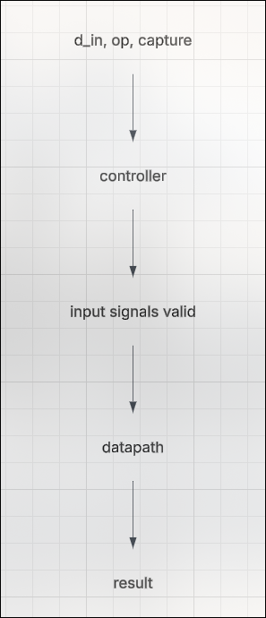
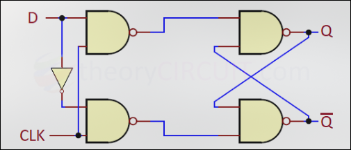
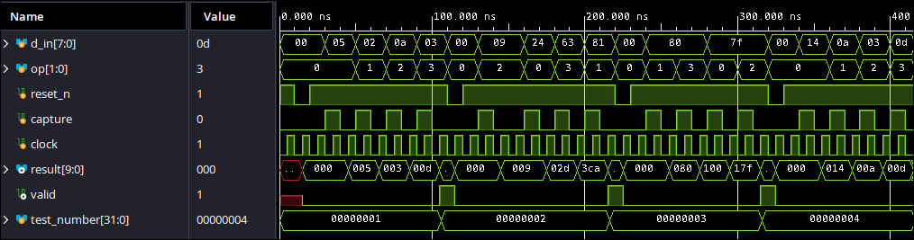
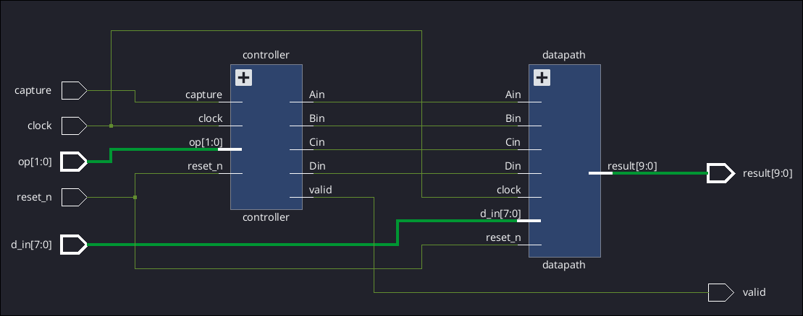
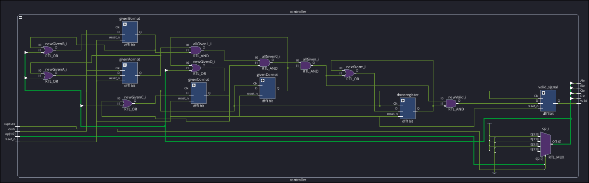
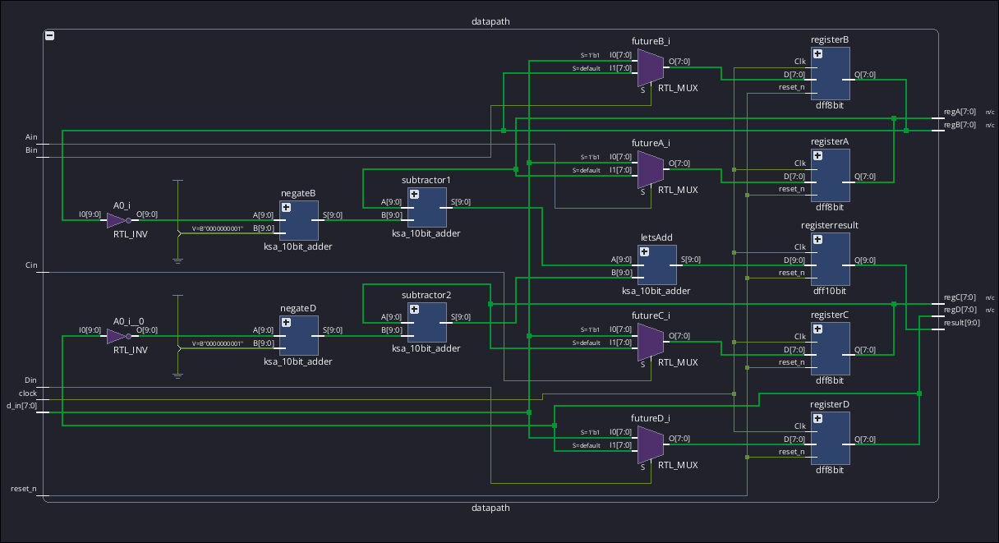

# Introduction

This design consists of a synchronous digital system that takes in four
signed 8 bit operands and computes the $(A - B) + (C - D)$ expression.
All 4 operands are received through the same input signal, $d\_in$. The
op signal indicates whether A, B, C, or D is the current input while the
capture signal indicates that the input should be stored in a register.
Since the operands can be received in any possible order, the op signal
must be incorporated to send the input to the correct corresponding
register. The design also includes a clock signal, an active low
synchronous reset signal, $reset_n$, a 10 bit signed result, and a 1 bit
'valid' signal. The 'valid' signal indicates when the result has been
calculated and can be used in another module or a testbench. Structural
and dataflow modeling was used to implement this system, no behavioral
modeling was used. Therefore, the design was organized into separate
controller and datapath sections. D Flip-Flops (DFFs) were used for
register storage while combinational logic and structural arithmetic was
used to perform the data processing.

# Background, and Theory

## Two's Complement Signed Inputs

The numbers are signed 8 bit two's complement values which can represent
decimal values between -128 and +128. The most significant bit (MSB) is
considered the sign bit, 0 being positive, 1 bein negative. Before doing
the arithmetic operation, each input was sign extended to convert the 8
bit inputs into 10 bits to simplify the addition operations. The reason
for this is the final result requires 10 bits as the decimal value of
the result can be anywhere from -510 to +510, requiring a minimum of 10
bits to represent.

## Register Storage

The shared input interface means that the system doesn't receive
separate ports for A, B, C, and D. Instead, op identifies the proper
path for the current $d\_in$. The controller generates for \"load\"
signals:

- Ain for operand A

- Ain for operand A

- Bin for operand B

- Cin for operand C

- Din for operand D

Each \"load\" signal asserts only when capture is set high and op
selects the proper corresponding operand. The datapath then uses
multiplexers to choose either the new input or the current register
value. The selected value is stored on the next rising edge of the clock
and only on the rising edge of the clock. This allows the order to be
arbitrary but still handled correctly because they are organized
according to op.

## Controller

The controller is responsible for managing timing and control signals.
It keeps track of whether each operand has already been captured or not
using the flags:

- givenA for operand A

- givenB for operand B

- givenC for operand C

- givenD for operand D

Each flag is set when its relative operand is captured and remains set
until the system is reset. This is a necessary step as cases where an
input is 0 must also be valid. The system cannot determine whether an
operand has been received simply by checking whether the registers
contains a nonzero value or not. Once all four flags are set, the
controller sets the valid signal to high. The reset signal returns the
whole system to its original state.

## Arithmetic

The arithmetic was implemented using structural 10 bit Kogge-Stone
Adders (ksa). A ksa calculates carries using 'propagate' and 'generate'
signals.

Prefix stages combine these signals over increasing distances. For a 10
bit ksa, the stages account for distances of 1, 2, 4, and 8 bits. The
generated carry signals are used to then calculate the sum bits.
Subtraction was implemented in this case by using 2's complement to
negate the second number and a ksa to the negated number to the first.
In other words:

$$\begin{align}
    (A + \~B) + (C + \~D)
\end{align}$$

The datapath first forms the 2's complement of B and D, then performs
the subtraction operations beforer finally adding these results together
to satisfy the original expression.

# Implementation

## Overall Architecture

::: {#tab:results}
  ----------- ------------- --------------------------------
  $Signal$    $Direction$   $Description$
  `reset_n`   `input`       `Active-low synchronous reset`
  `clock`     `input`       `Free-running clock`
  `d_in`      `input`       `8-bit signed input`
  `op`        `input`       `2-bit operand selector`
  `capture`   `input`       `1-bit capture indicator`
  `result`    `output`      `10-bit signed result`
  `valid`     `output`      `1-bit valid indicator`
  ----------- ------------- --------------------------------

  : Top-Level Ports
:::

The design was implemented using three main modules: Project2,
controller, and datapath. The top-level module, Project2, connects the
controller and datapath modules and provides the required external
interface. The controller generates control signals and keeps track of
which operand has been received. The datapath stores the input operands
and performs the required arithmetic. Figure 1 shows the overall flow of
the system.

<figure id="fig:proj2design" data-latex-placement="htbp">

<figcaption>Architecture Overview</figcaption>
</figure>

The top level modules does not perform the arithmetic or control the
registers. Instead, it instantiates the controller and datapath modules
and connects their signals.

## Top Level Module

The top level module named project 2 has inputs clock, active low
synchronous reset, shared signal input d_in, operand selector op, and
capture signal. Its output are the signed 10 bit result and valid
indicator. The internal register outputs are named regA, regB, regC,
regD. These registers store the four operands after they are capture via
d_in. The controller and datapath modules communicate using four single
bit signals named Ain, Bin, Cin, and Din. Each signal indicates that the
input should be stored in its corresponding operand register.

## Controller Implementation

The controller decodes the op and capture inputs using continuous
assignments. The load signals are generated according to the mapping in
Table 2.

::: {#tab:results}
  ------ ----------- ---------------
  $op$   $Operand$   $Load Signal$
  `00`   `A`         `Ain`
  `01`   `B`         `Bin`
  `10`   `C`         `Cin`
  `11`   `D`         `Din`
  ------ ----------- ---------------

  : Top-Level Ports
:::

A load signal is asserted only when capture is high. For example, the
signal operand A is the same as $Ain = catpure AND (op ==00)$. The
controller also contains four one bit flags. These are givenA, givenB,
givenC, givenD. These flags record whether each operand has been
captured. They are implemented using one bit D flip flops and are
cleared by the active low synchronous reset. The following snippet of
code is the implementation of the next state equations:

        assign futureA = Ain ? d_in : regA; 
        assign futureB = Bin ? d_in : regB; 
        assign futureC = Cin ? d_in : regC; 
        assign futureD = Din ? d_in : regD;

The flags were kept separate from the operand registers due to zero
being a valid input. Therefore, a register a register containing zero
cannot be used to determine whether the corresponding input has been
received. Once all four operand flags are asserted, the controller
generates the 'valid' signal. A separate completion flag prevents
'valid' from repeatedly asserting after the calculation has finished.
The reset clears all controller state so that a new calculation can
begin.

## Datapath Implementation

The datapath contains the four operand registers, input multiplexers,
sign extension logic, arithmetic units, and result register. Each
operand register has a multiplexer at its input. The multiplexer selects
either the new d_in value or the register's current value. The operands
are sgtored as signed 8 bit values. Before arithmetic is performed, they
are sign extended to 10 bits. The sign-extension operation copies the
original sign bit into the two additional upper bits. This preserves the
numerical value of negative operands while allowing the arithmetic units
to operate at the required width.

## Subtraction Implementation

The subtraction operations were implemented using two's-complement
addition rather than the Verilog subtraction operator. The datapath
first computes the two's complement of B and D by negating and adding 1.
This gives us values for variables AminusB and CminusD which can then be
added together. This approach satisfies the structural arithmetic
requirement and allows the same adder design to be reused for both
addition and subtraction.

## Kogge-Stone Adder Implementation

The arithmetic units use a 10-bit structural Kogge--Stone adder. For
each bit, propagate and generate signals are formed:

$$\begin{align}
    P_i = A_i \oplus B_i \\
    G_i = A_i*B_i
\end{align}$$

The prefix network combines these signals across increasing distances.
The stages in the 10 bit implementation cover distances of 1, 2, 4, and
8 bits. These stages determine the carry entering each sum bit. The
final sum is generated by combining the propagate signal for each bit
with the carry entering that bit. The same 10 bit adder module is
instantiated multiple times in the datapath. The Kogge--Stone adder is
combinational, so its output changes whenever the stored operands
change.

## D Flip-flop Implementation

The design uses separate D flip-flop modules for 8 bit operand storage,
single bit controller signals, and 10 bit result storage. Each flip flop
uses a positive edge triggered clock. The reset is synchronous and
active low. Therefore, the stored value is cleared only when 'reset_n'
is low at a rising edge of the clock. When 'reset_n' is high, the flip
flops store their corresponding data inputs on each rising clock edge.

<figure id="fig:Dflipflop" data-latex-placement="htbp">

<figcaption>D Flip Flop</figcaption>
</figure>

## Results Timing

The operand registers update when their corresponding load signal is
asserted at a rising clock edge. After the final operand is stored, the
combinational arithmetic calculates the result. The result is then
stored in the 10bit result register. The 'valid' signal is asserted
after the controller determines that all four operands have been
received. Registering the result ensures that the output remains stable
when 'valid' is asserted and can be safely read by the receiving circuit
or testbench. The design therefore allows a delay between capturing the
final operand and asserting 'valid', as permitted by the project
requirements. The result must be available within 10 clock cycles of the
final operand capture.

::: flushleft
# Results and Analysis

The design was tested using the project autograder. The tests included
continuous input sequences, discontinuous input sequences, and sequences
containing pauses between captured operands.

The register-related tests passed, demonstrating that the input
interface correctly stored the operands in the appropriate registers. In
particular, the results showed that the 'op' signal correctly selected
the destination register, the 'capture' signal controlled when data was
stored, inputs could arrive in different orders, pauses between operands
did not corrupt the stored values the reset behavior returned the
registers and control flags to their initial states. One example test
was:

        A=127,B=−128,C=127,D=−128

With an expected result of 510. A comprehensive testbench was created in
order to show the waveform of the results as seen in figure 4.

<figure id="fig:Waveform of Results" data-latex-placement="htbp">

<figcaption>Waveform of Results</figcaption>
</figure>

The waveform should show the four input values being captured on clock
edges, the corresponding 'regA'--'regD' registers updating, and 'valid'
asserting after the final operand has been received. The result should
be stable when 'valid' is high.

In Vivado 2026.1, an elaboratred design can be generated from the
written code to show the hardware architecture. Figure 5 represents the
top level module while figures 6 and 7 represent the controller and
datapth modules respectively.

<figure id="fig:Top Level Module Schematic" data-latex-placement="htbp">

<figcaption>Top Level Module Schematic</figcaption>
</figure>

<figure id="fig:Controller Module Schematic"
data-latex-placement="htbp">

<figcaption>Controller Module Schematic</figcaption>
</figure>

<figure id="fig:Datapath Module Schematic" data-latex-placement="htbp">

<figcaption>Datapath Module Schematic</figcaption>
</figure>

# Discussion
:::

The final architecture separates the design into a datapath and a
controller. This separation makes the design easier to understand
because the datapath performs the actual storage and arithmetic while
the controller manages timing and control signals. A major design
consideration was the shared input interface. Since all four operands
use d_in, the controller must decode op and generate the correct load
signal. The use of separate received flags was also important. Checking
whether a register contains a nonzero value would not work because zero
is a valid input. The flags provide an independent indication that each
operand has been captured.

Another important issue was signed arithmetic. The operands were stored
as 8-bit values but extended to 10 bits before arithmetic. Without sign
extension, negative values would be interpreted incorrectly during
subtraction. The 10 bit width also prevents overflow for the full range
of possible input values.

The result and 'valid' timing required careful consideration. The
operands are stored on clock edges, while the arithmetic datapath is
combinational. The controller must therefore assert valid only after all
four operands have been captured and the result is available.
Registering the result provides a stable output for the receiving
circuit. The autograder results indicate that the operand storage and
input control portions of the design functioned correctly. Any remaining
failures were associated with the timing or arithmetic- esult interface
rather than the register loading mechanism.

::: flushleft
# Conclusion

This project demonstrated the design of a clocked digital system using
structural and dataflow Verilog. The final circuit accepts four signed
operands through a shared input interface, stores them in the correct
registers, computes (A−B)+(C−D), and indicates when the result is
available.

The controller/datapath organization allowed the input handling logic
and arithmetic hardware to be separated clearly. The project also
reinforced the use of two's-complement arithmetic, sign extension,
flip-flop-based storage, multiplexers, and prefix adders. The autograder
results confirmed that the register capture supported continuous,
discontinuous, and paused input sequences. The remaining evaluation
focused on ensuring that the arithmetic output and valid signal were
aligned correctly.

# Work Cited

This report was compiled using LaTeX .
:::
